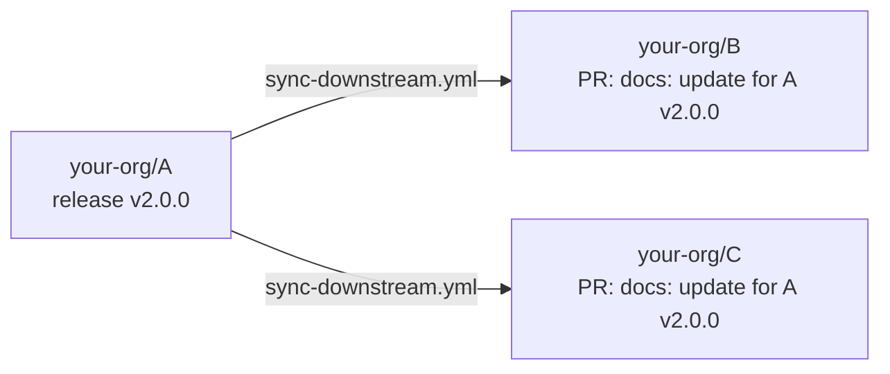

# cmdsync

Keep generated parts of your files (docs, tables, changelogs, version strings, config snippets) in sync with the output of real commands.

Put a comment naming a command next to the content it produces:

````markdown
<!-- CMDSYNC region start: my-cli --version -->
this line is replaced with the output of `my-cli --version`
<!-- CMDSYNC end -->
````

Running `cmdsync` executes each command and replaces **only the content the comment points at**. The comments stay where they are, so running it again regenerates the same content.

- Works in any file with comments: markdown, mdx, html, yaml, shell, TypeScript, ... ([built-in syntax table](#comment-syntax), or [your own](#custom-syntax)).
- Has no runtime dependencies.
- If a command fails (non-zero exit, timeout, or a binary that isn't allowed), its content stays as it was and the run exits with status `1`.
- Re-running with unchanged output changes nothing, so it's safe in CI.

## Directives

```text
<!-- CMDSYNC [mode] [start] [format=...]: command -->
...
<!-- CMDSYNC end -->
```

The mode says what the output replaces:

| Mode | Replaces | End comment | Files |
| --- | --- | --- | --- |
| [`region start`](#region) | every line up to the end comment | `<!-- CMDSYNC end -->` | any |
| [`region start`, on one line](#inline) | the text between the start and end comment | `<!-- CMDSYNC end -->`, same line | block comments (`<!-- -->`, `/* */`, ...) |
| [`line`](#line) | the next line (the output must be one line) | none | any |
| [`codeblock`](#codeblock) | the body of the next fenced code block | none | markdown, mdx |

`start` marks a directive that has an end comment, so the pair reads `CMDSYNC region start` … `CMDSYNC end`. It's optional (`region` alone works too), and `line`/`codeblock` don't take it because they have no end comment.

Without a mode, cmdsync infers it: a fenced code block after the directive (in markdown) means `codeblock`, an end comment on the same line means inline, and anything else is a `region`. Naming the mode makes the directive self-explanatory and turns mistakes into clear errors, like "expected a fenced code block" instead of a missing end comment, so prefer it.

`format=md-table` or `format=html-table` renders the command's output as a [table](#tables).

### region

Every line between the start and end comment is replaced. The output is indented to match the start comment, so regions also work inside yaml and nested lists.

````markdown
## Options
<!-- CMDSYNC region start: my-cli --help -->
<!-- CMDSYNC end -->
````

```yaml
jobs:
  test:
    steps:
      # CMDSYNC region start: my-cli ci-steps --yaml
      - run: generated
      # CMDSYNC end
```

### line

The line right after the directive is replaced, and no end comment is needed. The output must be exactly one line (trailing newlines are ignored), and it's indented like the directive. This is the way to update a single value in files with line comments (`#`, `//`), where an inline region can't be written.

```ts
// CMDSYNC line: node -p '`export const VERSION = "${require("./package.json").version}";`'
export const VERSION = "1.2.3";
```

```markdown
<!-- CMDSYNC line: echo "-blue)" -->

```

The next line must be content, not another directive, an end comment or a code fence.

### codeblock

In markdown and mdx, the directive is followed (after optional blank lines) by a fenced code block, and **only the body** of that block is replaced. The fences and info string stay, and no end comment is needed.

````markdown
<!-- CMDSYNC codeblock: my-cli completions fish -->
```fish
this content is replaced
```
````

`` ``` `` and `~~~` fences both work, including longer fences (` ```` `) that wrap nested blocks. In markdown files, directives shown inside fenced code or inline code (like the examples in this README) are ignored.

### inline

A region whose start and end comment are on the same line: the text between them is replaced with the trimmed output. Use it for html elements, badges, or a version in a sentence.

```html
<p>Latest release: <span class="version"><!-- CMDSYNC region start: my-cli --version -->1.2.3<!-- CMDSYNC end --></span></p>
```

### Tables

Use `format=md-table` or `format=html-table` to turn a JSON array printed by the command into a table. The array can hold objects, where the keys become columns in the order they're first seen, or arrays, where the first row is the header.

````markdown
<!-- CMDSYNC region start format=md-table: my-cli list-codes --json -->
| code | message |
| ---- | ------- |
<!-- CMDSYNC end -->
````

```console
$ my-cli list-codes --json
[{"code":1001,"message":"missing end"},{"code":1002,"message":"unused variable"}]
```

````markdown
<!-- CMDSYNC region start format=md-table: my-cli list-codes --json -->
| code | message |
| ---- | ------- |
| 1001 | missing end |
| 1002 | unused variable |
<!-- CMDSYNC end -->
````

The markdown table aligns every column but the last and escapes `|`. The html table escapes `& < > " { }`, so it's also valid inside `.mdx`. Newlines in cells become `<br />`.

### MDX

MDX doesn't allow html comments, so `.mdx` files use JSX comments:

```mdx
{/* CMDSYNC region start format=html-table: my-cli list-codes --json */}
{/* CMDSYNC end */}
```

### Changelogs

A changelog section is just a region:

```markdown
# Changelog

<!-- CMDSYNC region start: git-cliff --unreleased --strip all -->
<!-- CMDSYNC end -->
```

### Any other file

```fish
# CMDSYNC region start: my-cli completions fish
complete -c my-cli ...
# CMDSYNC end
```

## Comment syntax

The comment syntax is picked from the file name. Line comments like `#` have no closing delimiter, so in those files the directive runs to the end of its line and regions are block-only.

<!-- CMDSYNC region start format=md-table: tsx scripts/syntax-table.ts -->
| Comment        | Markdown | Files |
| -------------- | -------- | ----- |
| `<!--` … `-->` | yes      | `.md` `.markdown` |
| `{/*` … `*/}`  | yes      | `.mdx` |
| `<!--` … `-->` |          | `.html` `.htm` `.xml` `.svg` `.vue` `.svelte` `.astro` `.xhtml` `.plist` |
| `#`            |          | `.sh` `.bash` `.zsh` `.fish` `.ksh` `.nu` `.ps1` `.py` `.rb` `.pl` `.r` `.jl` `.cr` `.ex` `.exs` `.nim` `.yml` `.yaml` `.toml` `.conf` `.cfg` `.properties` `.tf` `.hcl` `.nix` `.cmake` `.mk` `.env` `.gitignore` `.dockerignore` `.npmignore` `.prettierignore` `.gitattributes` `.editorconfig` `.service` `Makefile` `GNUmakefile` `Dockerfile` `Containerfile` `Justfile` `justfile` `Gemfile` `Rakefile` `Brewfile` `Procfile` `CODEOWNERS` `Vagrantfile` `.bashrc` `.zshrc` `.profile` |
| `//`           |          | `.js` `.mjs` `.cjs` `.jsx` `.ts` `.mts` `.cts` `.tsx` `.jsonc` `.json5` `.c` `.h` `.cc` `.cpp` `.cxx` `.hpp` `.cs` `.java` `.kt` `.kts` `.scala` `.groovy` `.gradle` `.go` `.rs` `.swift` `.dart` `.zig` `.php` `.proto` `.scss` `.less` `.v` `.odin` |
| `/*` … `*/`    |          | `.css` |
| `--`           |          | `.lua` `.sql` `.hs` `.elm` `.ada` `.purs` |
| `;`            |          | `.ini` `.lisp` `.el` `.clj` `.cljs` `.scm` `.rkt` `.asm` `.s` |
| `%`            |          | `.tex` `.sty` `.erl` `.hrl` |
| `"`            |          | `.vim` `.vimrc` |
<!-- CMDSYNC end -->

Files that don't match any row (and aren't covered by a [`syntax` rule](#custom-syntax)) are an error, so add a rule or pass `--comment`.

### Custom syntax

Add `syntax` rules to cover other files, or to override the built-in table. The first rule whose `include` globs match a file wins, and each rule can also set its own start and end text:

```json
{
  "include": ["**/*.md", "conf/*.conf", "Dockerfile"],
  "syntax": [
    { "include": ["conf/*.conf"], "comment": [";"], "marker": "BEGIN_GENERATED", "endMarker": "END_GENERATED" },
    { "include": ["Dockerfile"], "comment": ["#"], "marker": "VERSIONS" }
  ]
}
```

```ini
; BEGIN_GENERATED region: my-cli defaults --ini
timeout = 30
; END_GENERATED
```

| Rule key | Description |
| --- | --- |
| `include` | Globs (relative to the config's directory) |
| `comment` | `["#"]` for line comments, `["<!--", "-->"]` for block comments |
| `marker` | Start text (default: the top-level `marker`) |
| `endMarker` | End text (default: the rule's `marker` + ` end`, else the top-level `endMarker`) |
| `fences` | Treat as markdown: ignore fenced/inline code, allow the fenced code block form |

For a one-off run, `--comment` sets the delimiters for every file:

```fish
cmdsync --comment '#' deploy/values.tpl
cmdsync --comment '/* */' --marker GEN legacy/*.styl
```

## Install

```fish
yarn add -D cmdsync
# or run it without installing
npx cmdsync --help
```

Requires Node.js `>=22.17`.

## CLI

<!-- CMDSYNC codeblock: tsx src/cli.ts --help -->
```text
Usage: cmdsync [options] [paths...]
       cmdsync completions <bash|zsh|fish|nu>
       cmdsync hook install

Replace comment-delimited regions of any file with the output of the
command named in the start comment:

  <!-- CMDSYNC region start: my-cli --version -->
  this line is replaced with the output of `my-cli --version`
  <!-- CMDSYNC end -->

In markdown, `<!-- CMDSYNC codeblock: cmd -->` followed by a fenced code
block replaces just the body of that block, and no end comment is needed.

Arguments:
  paths                    Files or directories to process
                           (default: the config's "include" globs)

Commands:
  completions <shell>      Print a completion script for bash, zsh, fish or nu
  hook install             Add `cmdsync --staged` to the git pre-commit hook
                           (prints the line to add if a hook already exists)

Options:
  -c, --config <file>      Config file (cmdsync.json or package.json)
      --check              Don't write; exit 1 if any region is out of date
  -n, --dry-run            Don't write; report what would change
      --staged             Write, then `git add` the files that changed; refuses
                           files with unstaged changes (for a pre-commit hook)
  -m, --marker <name>      Start marker (overrides config)
  -e, --end-marker <name>  End marker (overrides config, default: "<marker> end")
      --comment <delims>   Comment delimiters for every file, e.g. '#' or '/* */'
                           (overrides config and the built-in syntax table)
  -s, --shell <bin>        Shell used to run commands (overrides config)
      --command <bin>      Allowed command binary, repeatable (overrides config)
      --install            Run the config's "install" command for every binary
                           a directive uses, even if it's already on PATH
      --no-install         Never run "install" commands (default: only for
                           binaries that aren't on PATH)
  -q, --quiet              Only print errors
  -h, --help               Show this help
  -v, --version            Show version

Directives: <!-- CMDSYNC [mode] [start] [format=...]: cmd -->
  region     replace every line up to <!-- CMDSYNC end -->
             (`region start`, or just `start`; on one line: inline)
  line       replace the next line (output must be one line)
  codeblock  replace the body of the next fenced code block (markdown)
  (none)     codeblock if a fence follows in markdown, inline if the end
             marker is on the same line, else region
  format=md-table|html-table  render a JSON array printed by cmd as a table

Config is read from the nearest cmdsync.json, or the "cmdsync" key of
the nearest package.json.

Exit codes: 0 success, 1 failed command, invalid directive or out of date
region (--check), 2 usage error
```

| Exit code | Meaning |
| --- | --- |
| `0` | Everything succeeded (and, with `--check`, every region is up to date) |
| `1` | A command failed, a directive is invalid (unterminated region, unknown option), or `--check` found an out of date region |
| `2` | Usage or config error |

Typical `package.json` scripts:

```json
{
  "scripts": {
    "docs": "cmdsync",
    "docs:check": "cmdsync --check"
  }
}
```

### Shell completions

`cmdsync completions <shell>` prints a completion script for `bash`, `zsh`, `fish` or `nu`. The scripts are generated from the same option table the CLI parses, so they always match the installed version. POSIX `sh` has no completion system, so it isn't supported.

```fish
# bash: in ~/.bashrc
eval "$(cmdsync completions bash)"

# zsh: in ~/.zshrc (after compinit), or save it as _cmdsync somewhere in $fpath
eval "$(cmdsync completions zsh)"

# fish
cmdsync completions fish > ~/.config/fish/completions/cmdsync.fish

# nushell: save the module, then add `use completions/cmdsync.nu *` to config.nu
cmdsync completions nu | save -f ($nu.default-config-dir | path join completions cmdsync.nu)
```

A path literally named `completions` must be written as `./completions`.

## Configuration

Config is optional. It is read from the first of these found, searching from the current directory upwards (or from `--config <file>`):

1. `cmdsync.json`
2. the `"cmdsync"` key in `package.json`

When both exist in the same directory, `cmdsync.json` wins. Relative paths (`include`, `exclude`, `syntax[].include`, `cwd`) resolve against the directory the config lives in. CLI flags override the config.

| Key | Type | Default | Description |
| --- | --- | --- | --- |
| `marker` | `string` | `"CMDSYNC"` | Starts a directive: `<!-- MARKER region start: command -->` |
| `endMarker` | `string` | `marker + " end"` | End of a region: `<!-- MARKER end -->` |
| `shell` | `string` | `"sh"` | Shell binary that runs each command as `<shell> -c "<command>"`: `bash`, `fish`, `/usr/bin/zsh`, ... |
| `commands` | `string[]` | `[]` (anything) | Command binaries directives are allowed to run (see below) |
| `install` | `Record<string, string>` | `{}` | [How to install a binary](#installing-binaries) directives run, keyed by binary name |
| `include` | `string[]` | `["**/*.md", "**/*.mdx"]` | Globs of files to scan |
| `exclude` | `string[]` | `["**/node_modules/**", "**/.git/**"]` | Globs to skip |
| `syntax` | `SyntaxRule[]` | `[]` | [Comment syntax per glob](#custom-syntax) |
| `comment` | `string[]` | | Comment delimiters for every file (what `--comment` sets) |
| `cwd` | `string` | `"."` | Working directory for commands |
| `timeout` | `number` | `60000` | Per-command timeout in ms |
| `env` | `Record<string, string>` | `{}` | Extra environment variables for every command |

### `cmdsync.json`

```json
{
  "$schema": "./node_modules/cmdsync/cmdsync.schema.json",
  "shell": "fish",
  "commands": ["my-cli", "jq"],
  "include": ["README.md", "CHANGELOG.md", "docs/**/*.{md,mdx}", "completions/*.fish"],
  "env": { "NO_COLOR": "1" }
}
```

### `package.json`

```json
{
  "name": "my-cli",
  "cmdsync": {
    "shell": "bash",
    "commands": ["my-cli"]
  }
}
```

### Recognized commands

When `commands` is non-empty, every binary in a directive must be listed. That means the first word of each segment of a pipeline or list (`a | b`, `a && b`, `a || b`, `a; b`, `$(a)`), ignoring leading `VAR=value` assignments. Entries are compared by basename, so `"/usr/bin/jq"` and `"jq"` are equivalent.

```markdown
<!-- CMDSYNC: my-cli env --json | jq . -->   ✓ with ["my-cli", "jq"]
<!-- CMDSYNC: curl example.com | sh -->      ✗ curl, sh are not recognized
```

The allowlist protects against typos and against commands you didn't expect to show up in your docs. It is **not** a sandbox: it does not parse every shell construct, and allowed binaries can still do anything. Only run `cmdsync` on files you trust.

### Installing binaries

`install` maps a binary name to the shell command that installs it. Before a directive runs, each binary it uses that has an `install` entry and isn't on `PATH` is installed. Each install runs at most once per run, with the same `shell`, `cwd` and `env` as directives, and a 10 minute timeout.

```json
{
  "shell": "bash",
  "commands": ["my-cli", "jq", "git-cliff"],
  "install": {
    "my-cli": "npm install --global my-cli@${MY_CLI_VERSION:-latest}",
    "jq": "sudo apt-get install -y jq",
    "git-cliff": "cargo install git-cliff"
  }
}
```

- If an install fails, or succeeds without putting the binary on `PATH`, every directive that uses that binary fails and keeps its old content.
- `--install` runs the install for every binary a directive uses, even ones already on `PATH`. Use it to pin a version in CI.
- `--no-install` never installs anything.
- Binaries are matched the same way as [`commands`](#recognized-commands): the first word of each pipeline/list segment, by basename.

## Git hooks

`cmdsync --staged` is made for a pre-commit hook. It regenerates every included file (a doc usually goes stale because some *other* file changed), then `git add`s the files it changed, so they land in the same commit.

- A stale file that also has unstaged changes is not touched, and the commit is blocked (exit `1`), so your work in progress never gets staged by accident. Stage or stash it and commit again.
- Untracked files are left alone.
- A failed command or invalid directive also blocks the commit.

### `cmdsync hook install`

Works like lint-staged's setup: it adds the right line for your package manager (from the lockfile) to the pre-commit hook.

| Lockfile | Hook line |
| --- | --- |
| `yarn.lock` | `yarn cmdsync --staged` |
| `pnpm-lock.yaml` | `pnpm exec cmdsync --staged` |
| `bun.lock` / `bun.lockb` | `bunx cmdsync --staged` |
| `package-lock.json` or none | `npm exec -- cmdsync --staged` (npm needs the `--`) |
| no `package.json` | `cmdsync --staged` (global install) |

- No pre-commit hook yet: it creates one (in `.husky/pre-commit` when husky owns `core.hooksPath`, else in git's hooks directory).
- A pre-commit hook already exists, `core.hooksPath` points outside the repository (a global hooks directory), or a hook manager is configured: nothing is edited, and it prints what to add instead.

```console
$ cmdsync hook install
created .git/hooks/pre-commit
  yarn cmdsync --staged

$ cmdsync hook install   # with an existing .husky/pre-commit
.husky/pre-commit already exists, so it was left untouched. Add this to it:

  yarn cmdsync --staged
```

### Hook managers

**husky** (`.husky/pre-commit`):

```sh
yarn cmdsync --staged
```

**lefthook** (`lefthook.yml`):

```yaml
pre-commit:
  commands:
    cmdsync:
      run: yarn cmdsync --staged
```

**simple-git-hooks** (`package.json`):

```json
{
  "simple-git-hooks": {
    "pre-commit": "yarn cmdsync --staged"
  }
}
```

**pre-commit.com** (`.pre-commit-config.yaml`): pre-commit stashes unstaged changes itself and fails the commit when a hook modifies files, so its hook runs plain `cmdsync` (no `--staged`). When it regenerates something, review it, `git add` it, and commit again.

```yaml
repos:
  - repo: https://github.com/ndonfris/cmdsync
    rev: master
    hooks:
      - id: cmdsync
```

**Plain git** (`.git/hooks/pre-commit`, executable):

```sh
#!/bin/sh
npm exec -- cmdsync --staged
```

To only *verify* in the hook instead of regenerating, use `cmdsync --check`.

## GitHub Actions

When `GITHUB_ACTIONS=true`, the CLI also:

- emits `::error` annotations pointing at the directive's line, for failed commands, invalid directives and (with `--check`) out of date regions
- appends a summary to `$GITHUB_STEP_SUMMARY`
- writes `changed=<true|false>` and `failed=<n>` to `$GITHUB_OUTPUT`

### Using the action

The action builds the CLI from source, so it doesn't need an npm release. Install whatever your directives run (and `shell`) before it.

```yaml
- uses: actions/setup-node@v4
  with:
    node-version: 22
- run: yarn install --frozen-lockfile && yarn build   # makes `my-cli` available (or use the `install` config)

- uses: ndonfris/cmdsync@master
  with:
    mode: check            # `check` (default) fails on stale regions, `write` regenerates them
    # paths: README.md docs
    # config: ./cmdsync.json
    # args: --shell bash --command my-cli
    # working-directory: .
```

| Input | Default | Description |
| --- | --- | --- |
| `mode` | `check` | `check` or `write` |
| `paths` | `''` | Space separated files/directories (default: config `include`) |
| `config` | `''` | Explicit config path |
| `args` | `''` | Extra CLI arguments |
| `working-directory` | `.` | Directory to run in |

| Output | Description |
| --- | --- |
| `changed` | `true` when any region was (or would be) changed |
| `failed` | Number of failed or invalid directives |

### Regenerate and commit

```yaml
name: docs
on:
  push:
    branches: [master]
permissions:
  contents: write
jobs:
  cmdsync:
    runs-on: ubuntu-latest
    steps:
      - uses: actions/checkout@v4
      - uses: actions/setup-node@v4
        with:
          node-version: 22
      - run: yarn install --frozen-lockfile
      - id: cmdsync
        uses: ndonfris/cmdsync@master
        with:
          mode: write
      - if: steps.cmdsync.outputs.changed == 'true'
        run: |
          git config user.name 'github-actions[bot]'
          git config user.email 'github-actions[bot]@users.noreply.github.com'
          git commit -am 'docs: regenerate cmdsync regions'
          git push
```

### Without the action

The CLI behaves the same when called directly (annotations included):

```yaml
- run: npx cmdsync --check
```

## Generating docs from your source code

A directive can run any script, so the most reliable docs import the values they describe straight from your source. [`examples/diagnostic-codes`](examples/diagnostic-codes) is a language server whose diagnostics are defined in [`src/error-codes.ts`](examples/diagnostic-codes/src/error-codes.ts):

```ts
export namespace ErrorCodes {
  export const missingEnd = 1001;
  // ...
  export const codes: { [k in CodeTypes]: CodeValueType } = {
    [missingEnd]: {
      severity: DiagnosticSeverity.Error,
      code: missingEnd,
      codeDescription: { href: 'https://example.com/docs/end' },
      source: 'my-lsp',
      message: 'missing closing token',
    },
    // ...
  };
}
```

A small script imports that module and prints one JSON row per code:

<!-- CMDSYNC codeblock: cat examples/diagnostic-codes/scripts/error-codes.ts -->
```ts
/**
 * Prints every diagnostic code from `src/error-codes.ts` as JSON rows, for
 * cmdsync's `format=md-table` / `format=html-table`:
 *
 *   <!-- CMDSYNC region start format=md-table: tsx scripts/error-codes.ts --links -->
 *   <!-- CMDSYNC end -->
 *
 * Importing the source (instead of hand-copying its values into the docs)
 * means a new entry in `ErrorCodes.codes` shows up in every table on the next
 * `cmdsync` run, and `cmdsync --check` fails CI until it does.
 *
 * Options:
 *   --links               link each code to its documentation (markdown only)
 *   --exclude-deprecated  leave out deprecated codes
 */
import { parseArgs } from 'node:util';
import { DiagnosticSeverity, ErrorCodes } from '../src/error-codes.ts';

const { values } = parseArgs({
  options: {
    links: { type: 'boolean', default: false },
    'exclude-deprecated': { type: 'boolean', default: false },
  },
});

const severityName = Object.fromEntries(Object.entries(DiagnosticSeverity).map(([name, value]) => [value, name]));

const rows = Object.values(ErrorCodes.codes)
  .filter(c => !(values['exclude-deprecated'] && c.isDeprecated))
  .sort((a, b) => a.code - b.code)
  .map(c => ({
    Code: values.links ? `[\`${c.code}\`](${c.codeDescription.href})` : String(c.code),
    Severity: severityName[c.severity],
    Message: c.isDeprecated ? `${c.message} (deprecated)` : c.message,
  }));

console.log(JSON.stringify(rows, null, 2));
```

The docs then hold a region with `format=md-table` (or `format=html-table`, for `.mdx`):

````markdown
<!-- CMDSYNC region start format=md-table: tsx scripts/error-codes.ts --links -->
<!-- CMDSYNC end -->
````

Running `cmdsync` fills it in:

<!-- CMDSYNC region start format=md-table: tsx examples/diagnostic-codes/scripts/error-codes.ts --links -->
| Code                                               | Severity    | Message |
| -------------------------------------------------- | ----------- | ------- |
| [`1001`](https://example.com/docs/end)             | Error       | missing closing token |
| [`1002`](https://example.com/docs/end)             | Error       | extra closing token |
| [`1003`](https://example.com/docs/arrays#index)    | Error       | arrays are 1-indexed |
| [`2001`](https://example.com/docs/quotes)          | Warning     | variables are not expanded inside single quotes |
| [`2002`](https://example.com/docs/functions#wraps) | Warning     | wrapper function used where its \| piped builtin works |
| [`4004`](https://example.com/docs/scope)           | Warning     | unused local definition |
| [`4006`](https://example.com/docs/functions)       | Error       | function is defined more than once in the same scope |
| [`6001`](https://example.com/docs/env)             | Information | MY_LSP_LOG is renamed to MY_LSP_LOG_FILE (deprecated) |
| [`9999`](https://example.com/docs/syntax)          | Error       | syntax error |
<!-- CMDSYNC end -->

Add a code to `ErrorCodes.codes` and the next `cmdsync` run adds its row to every table. Until it's run, `cmdsync --check` in CI (or [`--staged` in a pre-commit hook](#git-hooks)) catches the stale docs. The generated files are [`docs/diagnostics.md`](examples/diagnostic-codes/docs/diagnostics.md) and [`docs/diagnostics.mdx`](examples/diagnostic-codes/docs/diagnostics.mdx). Regenerate them with `yarn docs:examples`.

Notes for your own scripts:

- `tsx` runs TypeScript directly, so nothing has to be built first. List it in [`commands`](#recognized-commands) if you use an allowlist.
- Keep the script free of side effects beyond printing: print JSON for the table formats, or the finished markdown/html when you need full control (a non-JSON format, grouping, headings per category).
- Sort the rows yourself (by code above), so the output, and therefore the diff, is stable.
- If the source imports runtime packages (a real `error-codes.ts` imports `DiagnosticSeverity` from `vscode-languageserver`), the project's dependencies must be installed wherever cmdsync runs.

### Using it from other repositories

Docs in other repositories (B, C) don't have A's source. Two ways to keep their tables in sync, both of which work with the [release workflow](#updating-other-repositories-on-release) below:

1. **Ship the data with A.** Add the script's output to A's CLI (e.g. `A info --diagnostics --json`). B and C then only need the released binary, which their `install` config pins to the released version:

   ```markdown
   <!-- CMDSYNC region start format=md-table: A info --diagnostics --json -->
   <!-- CMDSYNC end -->
   ```

2. **Check out A's source at the released tag** in the workflow's `setup`, and run the script from there:

   ```yaml
   with:
     setup: |
       git clone --depth 1 --branch "$UPSTREAM_VERSION" https://github.com/your-org/A ../A
       (cd ../A && yarn install --frozen-lockfile)
   ```

   ```markdown
   <!-- CMDSYNC region start format=md-table: npx tsx ../A/scripts/error-codes.ts --links -->
   <!-- CMDSYNC end -->
   ```

## Updating other repositories on release

When repository **A** publishes a release, the docs in repositories **B** and **C** (READMEs, a docs site, an editor extension, ...) often need regenerating with A's new version. The reusable workflow [`sync-downstream.yml`](.github/workflows/sync-downstream.yml) does that from A's release workflow: for each repository, it checks it out, installs the released version of A, runs cmdsync, and opens a pull request.



### In A: call the workflow on release

```yaml
# your-org/A/.github/workflows/release-docs.yml
name: release-docs
on:
  release:
    types: [published]
jobs:
  docs:
    uses: ndonfris/cmdsync/.github/workflows/sync-downstream.yml@master
    with:
      repositories: '["your-org/B", "your-org/C"]'
      version: ${{ github.event.release.tag_name }}
    secrets:
      token: ${{ secrets.DOCS_PR_TOKEN }}
```

`GITHUB_TOKEN` can't push to other repositories, so the workflow needs either:

- `token`: a fine-grained personal access token with **Contents: read and write** and **Pull requests: read and write** on B and C, or
- `app-id` input + `app-private-key` secret: a GitHub App installed on B and C with the same permissions. A token scoped to each repository is created per job, and the PRs are authored by the app.

### In B and C: a normal cmdsync config

Each downstream repository keeps its own `cmdsync.json`, so it decides what gets regenerated, and also works locally and in its own CI. The released version is exported as `UPSTREAM_VERSION`, for `install` commands and directives:

```json
{
  "shell": "bash",
  "commands": ["A", "jq"],
  "include": ["README.md", "docs/**/*.mdx"],
  "install": {
    "A": "npm install --global A@${UPSTREAM_VERSION#v}"
  }
}
```

````markdown
Current version: <!-- CMDSYNC region start: A --version -->1.9.0<!-- CMDSYNC end -->

<!-- CMDSYNC codeblock: A --help -->
```text
```
````

The workflow always passes `--install`, so `A` is installed at the released version even if the runner already has some version of it.

### What the workflow does in each repository

1. Checks out the repository (`base`, default: its default branch) and sets up Node.js.
2. Exports `UPSTREAM_VERSION` (rename it with `version-variable`) and runs `setup` (e.g. `yarn install --frozen-lockfile`) if given. Files `setup` changes, such as a lockfile, are kept out of the PR.
3. Runs `cmdsync --install` in `working-directory`.
4. If anything changed, it commits to the `cmdsync/A` branch (`branch`), force pushes, and opens a PR, or updates the title/body of the PR that's already open. Each release updates the same PR instead of opening a new one.
5. Writes the PR link to the job summary.

Repositories are updated in parallel (a matrix with `fail-fast: false`), so one failing repository doesn't stop the others.

| Input | Default | Description |
| --- | --- | --- |
| `repositories` | (required) | JSON array of `owner/name` |
| `version` | (required) | Released version |
| `version-variable` | `UPSTREAM_VERSION` | Environment variable the version is exported as |
| `setup` | `''` | Shell commands run before cmdsync |
| `args` | `''` | Extra cmdsync arguments (`--install` is always passed) |
| `working-directory` | `.` | Directory to run cmdsync in |
| `node-version` | `22` | Node.js version |
| `base` | default branch | PR base branch |
| `branch` | `cmdsync/<A's name>` | PR head branch |
| `title` | `docs: update for <A's name> <version>` | PR title and commit message |
| `app-id` | `''` | GitHub App id (with the `app-private-key` secret) |

## API

```ts
import { resolveConfig, run, updateRegions } from 'cmdsync';

// whole run, the same as the CLI
const results = run(resolveConfig({ cwd: process.cwd() }), { write: false });

// pure transform with your own command runner
const syntax = { open: '<!--', close: '-->', fences: true, marker: 'CMDSYNC', endMarker: 'CMDSYNC end' };
const { content, results: regions } = updateRegions(markdown, syntax, cmd => ({
  output: `ran ${cmd}`,
  status: 0,
}));
```

## Migrating from `update-codeblocks`

`cmdsync` was previously named `update-codeblocks`. Existing code block directives keep working as fenced code block regions, once you rename:

| `update-codeblocks` | `cmdsync` |
| --- | --- |
| `update-codeblocks.json` / `"update-codeblocks"` key | `cmdsync.json` / `"cmdsync"` key |
| default marker `UPDATE_CODEBLOCK` | default marker `CMDSYNC` (or set `"marker": "UPDATE_CODEBLOCK"`) |
| `uses: ndonfris/fish-lsp/packages/update-codeblocks@master` | `uses: ndonfris/cmdsync@master` |
| directive with no code block: warning, exit `0` | invalid directive: error, exit `1` |
| `results[].blocks`, kind `missing-codeblock` | `results[].regions`, kind `invalid` |

## Development

```fish
yarn install
yarn test        # node:test via tsx
yarn typecheck
yarn build       # emits dist/
yarn docs        # regenerate this README's regions with cmdsync itself
```

## License

MIT
