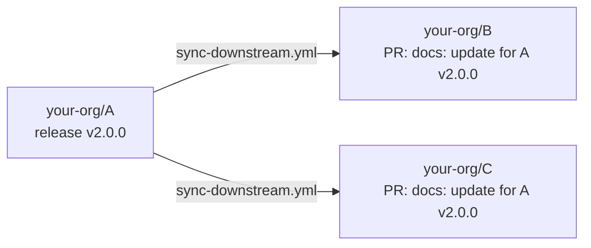

# cmdsync

[](https://www.npmjs.com/package/cmdsync) [](https://www.npmjs.com/package/cmdsync) <!-- CMDSYNC start: node -p "'[.engines.node) + '-339933?logo=nodedotjs&logoColor=white)](https://nodejs.org)'" -->[](https://nodejs.org)<!-- CMDSYNC end --> [](./LICENSE.md) [](./package.json) [](./src/index.ts)

Keep generated parts of your files (docs, tables, changelogs, version strings, config snippets) in sync with the output of real commands.

Put a comment naming a command next to the content it produces:

````markdown
<!-- CMDSYNC start: my-cli --version -->
this line is replaced with the output of `my-cli --version`
<!-- CMDSYNC end -->
````

Running `cmdsync` executes each command and replaces **only the content the comment points at**. The comments stay where they are, so running it again regenerates the same content.

- Works in any file with comments: markdown, mdx, html, yaml, shell, TypeScript, ... ([built-in syntax table](#comment-syntax), or [your own](#custom-syntax)).
- Has no runtime dependencies.
- If a command fails (non-zero exit, timeout, or a binary that isn't allowed), its content stays as it was and the run exits with status `1`.
- Re-running with unchanged output changes nothing, so it's safe in CI.

## Directives

```text
<!-- CMDSYNC [mode] [start] [format=...] [lang=...]: command -->
...
<!-- CMDSYNC end -->
```

The mode says what the output replaces:

| Mode | Replaces | End comment | Files |
| --- | --- | --- | --- |
| [`start` or `region start`](#region) | every line up to the end comment | `<!-- CMDSYNC end -->` | any |
| [`start`, on one line](#inline) | the text between the start and end comment | `<!-- CMDSYNC end -->`, same line | block comments (`<!-- -->`, `/* */`, ...) |
| [`line`](#line) | the next line (the output must be one line) | none | any |
| [`codeblock`](#codeblock) | the body of the next fenced code block | none | markdown, mdx |
| [`console`](#console) | the next fenced code block, with `$ command` and its output | none | markdown, mdx |
| [`console-pretty`](#console) | the next two fenced code blocks: the command, then its output | none | markdown, mdx |

`start` marks a directive that has an end comment, so the pair reads `CMDSYNC start` … `CMDSYNC end`. It's short for `region start`, so `<!-- CMDSYNC start: cmd -->` is always a region, even before a code block; the examples below use the short form. `region start` and `region` alone work too. `line`, `codeblock` and the `console` modes don't take `start`, because they have no end comment.

Without a mode, cmdsync infers it: a fenced code block after the directive (in markdown) means `codeblock`, an end comment on the same line means inline, and anything else is a `region`. Naming the mode (or writing `start`) makes the directive self-explanatory and turns mistakes into clear errors, like "expected a fenced code block" instead of a missing end comment, so prefer it.

`format=md-table` or `format=html-table` renders the command's output as a [table](#tables).

`include=path` [takes the content from a file](#including-files) instead of a command: `<!-- CMDSYNC start include=src/example.ts#L10-L20 -->`.

### region

Every line between the start and end comment is replaced. The output is indented to match the start comment, so regions also work inside yaml and nested lists. `start` and `region start` are the same:

````markdown
## Options
<!-- CMDSYNC start: my-cli --help -->
<!-- CMDSYNC end -->

## Version
<!-- CMDSYNC region start: my-cli --version -->
<!-- CMDSYNC end -->
````

```yaml
jobs:
  test:
    steps:
      # CMDSYNC start: my-cli ci-steps --yaml
      - run: generated
      # CMDSYNC end
```

### line

The line right after the directive is replaced, and no end comment is needed. The output must be exactly one line (trailing newlines are ignored), and it's indented like the directive. This is the way to update a single value in files with line comments (`#`, `//`), where an inline region can't be written.

```ts
// CMDSYNC line: node -p '`export const VERSION = "${require("./package.json").version}";`'
export const VERSION = "1.2.3";
```

```markdown
<!-- CMDSYNC line: echo "-blue)" -->

```

The next line must be content, not another directive, an end comment or a code fence.

### codeblock

In markdown and mdx, the directive is followed (after optional blank lines) by a fenced code block, and **only the body** of that block is replaced. The fences and info string stay (unless `lang=` is set, see below), and no end comment is needed.

````markdown
<!-- CMDSYNC codeblock: my-cli completions fish -->
```fish
this content is replaced
```
````

Add `lang=` to set the block's language. It replaces the first word of the info string (attributes after it, like `title="..."`, are kept), and if no fenced block follows the directive, one is created:

````markdown
<!-- CMDSYNC codeblock lang=fish: my-cli completions fish -->
````

becomes

````markdown
<!-- CMDSYNC codeblock lang=fish: my-cli completions fish -->
```fish
complete -c my-cli ...
```
````

A created block uses a fence longer than any fence in the output, so output that contains code blocks of its own stays intact. `lang` only applies to `codeblock` directives.

`` ``` `` and `~~~` fences both work, including longer fences (` ```` `) that wrap nested blocks. In markdown files, directives shown inside fenced code or inline code (like the examples in this README) are ignored.

### console

`console` shows the command with its output, the way it looks in a terminal. The directive owns the fenced code block after it, and creates it if there's none:

````markdown
<!-- CMDSYNC console: my-cli --version -->
```console
$ my-cli --version
1.2.3
```
````

`console-pretty` writes two blocks instead: the command, highlighted as `lang` (`sh` by default), then its output as `txt`:

````markdown
<!-- CMDSYNC console-pretty lang=fish: my-cli env -->
```fish
my-cli env
```

```txt
MY_CLI_HOME=~/.config/my-cli
```
````

Both are markdown/mdx only, and replace the block(s) right after the directive (only blank lines may come before each), so `console-pretty` takes the next two fenced blocks: keep unrelated code blocks out of that spot. `lang=` changes the language (`console lang=shell-session`). They don't take `format=` or `include=`, since the point is showing the real command.

### inline

A region whose start and end comment are on the same line: the text between them is replaced with the trimmed output. Use it for html elements, badges, or a version in a sentence.

```html
<p>Latest release: <span class="version"><!-- CMDSYNC start: my-cli --version -->1.2.3<!-- CMDSYNC end --></span></p>
```

### Including files

`include=` in place of `: command` takes the content from a file instead of running something. The path is relative to the file the directive is in, and `#L10-L20` (or `#L10`, `#L10-` for the rest of the file) picks a range of lines. A range is dedented, so a snippet from inside a function starts at column 0.

````markdown
<!-- CMDSYNC codeblock lang=ts include=../src/example.ts#L10-L20 -->
```ts
lines 10 to 20 of src/example.ts
```

<!-- CMDSYNC start include=../CONTRIBUTING.md -->
<!-- CMDSYNC end -->
````

It works with every mode, and with `format=` (`include=codes.json format=md-table`) and `lang=`. Includes don't run anything, so they don't need to be in [`commands`](#recognized-commands). A missing file, or a range past the end of it, fails the directive and leaves its content as it was.

### Tables

Use `format=md-table` or `format=html-table` to turn a JSON array printed by the command into a table. The array can hold objects, where the keys become columns in the order they're first seen, or arrays, where the first row is the header.

````markdown
<!-- CMDSYNC start format=md-table: my-cli list-codes --json -->
| code | message |
| ---- | ------- |
<!-- CMDSYNC end -->
````

```console
$ my-cli list-codes --json
[{"code":1001,"message":"missing end"},{"code":1002,"message":"unused variable"}]
```

````markdown
<!-- CMDSYNC start format=md-table: my-cli list-codes --json -->
| code | message |
| ---- | ------- |
| 1001 | missing end |
| 1002 | unused variable |
<!-- CMDSYNC end -->
````

The markdown table aligns every column but the last and escapes `|`. The html table escapes `& < > " { }`, so it's also valid inside `.mdx`. Newlines in cells become `<br />`.

### MDX

MDX doesn't allow html comments, so `.mdx` files use JSX comments:

```mdx
{/* CMDSYNC start format=html-table: my-cli list-codes --json */}
{/* CMDSYNC end */}
```

### Changelogs

A changelog section is just a region:

```markdown
# Changelog

<!-- CMDSYNC start: git-cliff --unreleased --strip all -->
<!-- CMDSYNC end -->
```

### Any other file

```fish
# CMDSYNC start: my-cli completions fish
complete -c my-cli ...
# CMDSYNC end
```

## Custom directives

Define your own directives in the config's `directives`, and use their names like a mode: `<!-- CMDSYNC quote start: my-cli greet -->`. Each one runs a command, then turns its output into what's written, with a `template`, a `formatter` module, or both:

```json
{
  "directives": {
    "quote": { "template": "{output|quote}" },
    "usage": { "mode": "codeblock", "lang": "text", "command": "{cmd} --help" },
    "version": { "mode": "line", "command": "my-cli --version", "template": "**{params.label|default:Version}:** `{output|trim}`" },
    "terminal": { "formatter": "./scripts/terminal.ts" }
  }
}
```

```markdown
<!-- CMDSYNC usage: my-cli -->
<!-- CMDSYNC version label=Latest: - -->
<!-- CMDSYNC terminal start lang=fish caption=Install: my-cli install -->
<!-- CMDSYNC end -->
```

| Key | Meaning |
| --- | --- |
| `mode` | The built-in mode that writes the result: `region` (default), `line`, `codeblock`, `console`, `console-pretty`. `start` and the end marker work the same as for that mode. |
| `command` | The command to run, with `{cmd}` for what the directive says (default: `{cmd}`). Any placeholder below works except the output ones. |
| `lang`, `format` | Defaults for `lang=` and `format=`. `format` applies to the output before the formatter and template. |
| `template` | The text written, with placeholders and filters (below). Runs after `formatter`, with its result as `{output}`. |
| `formatter` | A JS or TS module, relative to the config root. Its default export (or `format` export) gets the output and returns what's written. |
| `description` | Free text for people reading the config. |

On top of `format=`, `lang=` and `include=`, a custom directive takes any `key=value` word, which its template sees as `{params.key}` and its formatter as `ctx.params.key`. Values can use letters, digits and `_ . - + # / @ ~` (no spaces). [`examples/custom-directives`](examples/custom-directives) has a working setup of each kind.

### Templates

| Placeholder | Value |
| --- | --- |
| `{output}` | the command's output (after `format=`), or the formatter's result |
| `{input}` (or `{cmd}`) | the command as written in the directive |
| `{command}` | the command that ran (the custom directive's `command`, filled in) |
| `{name}`, `{mode}`, `{lang}` | the directive's name, base mode, and `lang=` |
| `{file}`, `{dir}`, `{line}` | the file with the directive (relative to the config root), its directory, the directive's line |
| `{marker}` | the config's marker |
| `{date}`, `{datetime}`, `{year}` | when it ran (UTC): `2026-11-02`, ISO 8601, `2026` |
| `{fence}` | a backtick fence longer than any inside `{output}`: `{fence}sh` … `{fence}` |
| `{env.NAME}` | an environment variable (the config's `env` included) |
| `{params.NAME}` | a `NAME=value` word of the directive |

Filters run left to right: `{output|trim|quote}`.

| Filter | Does |
| --- | --- |
| `trim` | strips surrounding whitespace |
| `quote`, `quote:<prefix>` | prefixes every line with `> ` (or `<prefix>`) |
| `indent`, `indent:<n or text>` | indents every non-empty line by 2 spaces (or `n` spaces, or `text`) |
| `code`, `code:<lang>` | wraps it in a fenced code block of `lang=` (or `<lang>`) |
| `first`, `last`, `lines` | the first line, the last line, the number of lines |
| `upper`, `lower` | changes case |
| `json`, `html` | JSON string literal; html-escaped |
| `default:<text>` | `<text>` when empty; also makes an unset `{params.x}` or `{env.X}` optional |

`{{` and `}}` are literal braces. An unknown placeholder or filter, or an unset `{params.x}` without `|default`, fails the directive with an error saying which.

### Formatters

A formatter is a function from the directive's context to the text that's written. In `region` mode that's the whole region, so it can add anything around the output: quotes, a code block for the command and another for its output, a caption, ... Import the types and helpers from `cmdsync` (installed as a dev dependency) to write it with completions and checks:

```ts
// scripts/terminal.ts
import { defineFormatter, fence } from 'cmdsync';

export default defineFormatter(ctx => [
  ...ctx.params.caption ? [`*${ctx.params.caption}*`, ''] : [],
  fence(ctx.input, ctx.lang ?? 'sh'),
  '',
  fence(ctx.output, 'txt'),
].join('\n'));
```

`ctx` (`FormatterContext`) is:

| Field | Value |
| --- | --- |
| `output` | the command's output (after `format=`) |
| `input` | the command as written in the directive |
| `name`, `mode`, `lang` | the custom directive's name, its base mode, and `lang=` (or the directive's default) |
| `params` | the directive's `key=value` words |
| `file`, `line` | the file with the directive (absolute), and the directive's line (1-based) |
| `config` | the resolved config |

Helpers to import from `cmdsync`: `fence(text, lang?)` (a fenced block, with a fence longer than any inside), `quote(text, prefix?)`, `indent(text, by?)`, and `renderTemplate(template, vars)` with `templateVars(ctx)` to fill a template string with the directive's placeholders.

It runs synchronously and must return a string; if it throws, the directive fails with that message and keeps its content. `.ts` formatters run with Node's built-in type stripping (Node `>=22.18`), so they can't use TypeScript-only syntax like `enum`. `cmdsync lint` reports formatters that fail to load, without running anything.

## Comment syntax

The comment syntax is picked from the file name. Line comments like `#` have no closing delimiter, so in those files the directive runs to the end of its line and regions are block-only.

<!-- CMDSYNC start format=md-table: tsx scripts/syntax-table.ts -->
| Comment        | Markdown | Files |
| -------------- | -------- | ----- |
| `<!--` … `-->` | yes      | `.md` `.markdown` |
| `{/*` … `*/}`  | yes      | `.mdx` |
| `<!--` … `-->` |          | `.html` `.htm` `.xml` `.svg` `.vue` `.svelte` `.astro` `.xhtml` `.plist` |
| `#`            |          | `.sh` `.bash` `.zsh` `.fish` `.ksh` `.nu` `.ps1` `.py` `.rb` `.pl` `.r` `.jl` `.cr` `.ex` `.exs` `.nim` `.yml` `.yaml` `.toml` `.conf` `.cfg` `.properties` `.tf` `.hcl` `.nix` `.cmake` `.mk` `.env` `.gitignore` `.dockerignore` `.npmignore` `.prettierignore` `.gitattributes` `.editorconfig` `.service` `Makefile` `GNUmakefile` `Dockerfile` `Containerfile` `Justfile` `justfile` `Gemfile` `Rakefile` `Brewfile` `Procfile` `CODEOWNERS` `Vagrantfile` `.bashrc` `.zshrc` `.profile` |
| `//`           |          | `.js` `.mjs` `.cjs` `.jsx` `.ts` `.mts` `.cts` `.tsx` `.jsonc` `.json5` `.c` `.h` `.cc` `.cpp` `.cxx` `.hpp` `.cs` `.java` `.kt` `.kts` `.scala` `.groovy` `.gradle` `.go` `.rs` `.swift` `.dart` `.zig` `.php` `.proto` `.scss` `.less` `.v` `.odin` |
| `/*` … `*/`    |          | `.css` |
| `--`           |          | `.lua` `.sql` `.hs` `.elm` `.ada` `.purs` |
| `;`            |          | `.ini` `.lisp` `.el` `.clj` `.cljs` `.scm` `.rkt` `.asm` `.s` |
| `%`            |          | `.tex` `.sty` `.erl` `.hrl` |
| `"`            |          | `.vim` `.vimrc` |
<!-- CMDSYNC end -->

Files that don't match any row (and aren't covered by a [`syntax` rule](#custom-syntax)) are an error, so add a rule or pass `--comment`.

### Custom syntax

Add `syntax` rules to cover other files, or to override the built-in table. The first rule whose `include` globs match a file wins, and each rule can also set its own start and end text:

```json
{
  "include": ["**/*.md", "conf/*.conf", "Dockerfile"],
  "syntax": [
    { "include": ["conf/*.conf"], "comment": [";"], "marker": "BEGIN_GENERATED", "endMarker": "END_GENERATED" },
    { "include": ["Dockerfile"], "comment": ["#"], "marker": "VERSIONS" }
  ]
}
```

```ini
; BEGIN_GENERATED region: my-cli defaults --ini
timeout = 30
; END_GENERATED
```

| Rule key | Description |
| --- | --- |
| `include` | Globs (relative to the config's directory) |
| `comment` | `["#"]` for line comments, `["<!--", "-->"]` for block comments |
| `marker` | Start text (default: the top-level `marker`) |
| `endMarker` | End text (default: the rule's `marker` + ` end`, else the top-level `endMarker`) |
| `fences` | Treat as markdown: ignore fenced/inline code, allow the fenced code block form |

For a one-off run, `--comment` sets the delimiters for every file:

```fish
cmdsync --comment '#' deploy/values.tpl
cmdsync --comment '/* */' --marker GEN legacy/*.styl
```

## Install

```fish
yarn add -D cmdsync
# or run it without installing
npx cmdsync --help
```

Requires Node.js `>=22.18`.

`cmdsync init` writes a starter `cmdsync.json` (or, with `--package-json`, a `"cmdsync"` key in `package.json`) and prints the next steps. It leaves an existing config alone, and points at [`cmdsync migrate`](#migrating-from-update-codeblocks) when it finds an `update-codeblocks` one.

## CLI

<!-- CMDSYNC codeblock: tsx src/cli.ts --help -->
```text
Usage: cmdsync [update] [options] [paths...]
       cmdsync status [options] [paths...]
       cmdsync check [options] [paths...]
       cmdsync lint [options] [paths...]
       cmdsync init [--package-json] | init global [--add]
       cmdsync repos [list | add [path] | remove <name>]
       cmdsync migrate [--from <marker>...] [--dry-run | --diff]
       cmdsync completions <bash|zsh|fish|nu>
       cmdsync hook install

Replace comment-delimited regions of any file with the output of the
command named in the start comment:

  <!-- CMDSYNC start: my-cli --version -->
  this line is replaced with the output of `my-cli --version`
  <!-- CMDSYNC end -->

In markdown, `<!-- CMDSYNC codeblock: cmd -->` followed by a fenced code
block replaces just the body of that block, and no end comment is needed.

Arguments:
  paths                    Files or directories to process
                           (default: the config's "include" globs)

Commands:
  update [paths...]        Regenerate every directive, write the files, then run
                           the config's "postUpdate" commands (the default)
  status [paths...]        Print a diff of what `update` would change, without
                           writing (same as --dry-run --diff, but exits 0)
  check [paths...]         Exit 1 if any region is out of date (same as --check)
  lint [paths...]          Check every directive without running commands or
                           writing, and list where each one is: invalid
                           options, missing end markers or includes, commands
                           outside "commands", stray markers (exit 1), and
                           binaries that aren't on PATH (warning)
  init                     Create a starter cmdsync.json here (--package-json:
                           a "cmdsync" key in package.json instead)
  init global              Create the global config (--add: and add this repo)
  repos                    List the global config's repositories
  repos add [path]         Add a repository (default: this one), with
                           --name <name> and --group <group>...
  repos remove <name>      Remove a repository, by name or path
  migrate                  Convert an update-codeblocks config and directives,
                           and directives in older cmdsync syntax (/CMDSYNC,
                           CMDSYNC[format=x]:), to the current syntax
                           (--dry-run: only list, --diff: show the changes);
                           --from <marker> also converts another marker's
                           directives (<!-- DOCS: cmd -->), repeatable
  completions <shell>      Print a completion script for bash, zsh, fish or nu
  hook install             Add `cmdsync --staged` to the git pre-commit hook
                           (prints the line to add if a hook already exists)

Options:
  -c, --config <file>      Config file (cmdsync.json or package.json)
      --show               Print the config (--config, or the nearest one) and
                           exit; for package.json, its "cmdsync" key
      --edit               Open the config in $VISUAL / $EDITOR / vi, and check
                           it when the editor exits
      --resolved           With --show (or alone): print the config a run would
                           use, merged from the defaults, the global config, the
                           config file and flags, marking where each value is from
      --check              Don't write; exit 1 if any region is out of date
  -n, --dry-run            Don't write; report what would change
  -i, --interactive        Show each change and ask whether to apply it
                           (y/n, a/d: all or none left in the file, q: quit)
  -d, --diff               Don't write; print a unified diff of what would
                           change, and exit 1 if anything is out of date
      --staged             Write, then `git add` the files that changed; refuses
                           files with unstaged changes (for a pre-commit hook)
  -m, --marker <name>      Start marker (overrides config)
  -e, --end-marker <name>  End marker (overrides config, default: "<marker> end")
      --comment <delims>   Comment delimiters for every file, e.g. '#' or '/* */'
                           (overrides config and the built-in syntax table)
  -s, --shell <bin>        Shell used to run commands (overrides config)
      --command <bin>      Allowed command binary, repeatable (overrides config)
      --install            Run the config's "install" command for every binary
                           a directive uses, even if it's already on PATH
      --no-install         Never run "install" commands (default: only for
                           binaries that aren't on PATH)
      --post-update-cmds   Run the config's "postUpdate" commands even if no
                           file changed
      --no-post-update-cmds
                           Never run "postUpdate" commands (default: run them
                           after an update that wrote at least one file)
      --all                Run in every repository of the global config
  -g, --group <name>       Run in the global config's repositories in a group,
                           repeatable
  -r, --repo <name>        Run in a global config repository, by name or path,
                           repeatable
  -q, --quiet              Only print errors
      --verbose            Also print every file scanned, and every command run
                           with its exit status and time
  -h, --help               Show this help
  -v, --version            Show version

Directives: <!-- CMDSYNC [mode] [start] [format=...] [lang=...]: cmd -->
            <!-- CMDSYNC [mode] [start] [...] include=path[#L1-L9] -->
  region     replace every line up to <!-- CMDSYNC end -->
             (`start` is short for `region start`; on one line: inline)
  line       replace the next line (output must be one line)
  codeblock  replace the body of the next fenced code block (markdown)
             (lang=fish sets its language, creating the block if missing)
  console    the next fenced code block, as `$ cmd` and its output
  console-pretty  two blocks: cmd (lang=, default sh), then its output (txt)
  (none)     codeblock if a fence follows in markdown, inline if the end
             marker is on the same line, else region
  format=md-table|html-table  render a JSON array printed by cmd as a table
  include=path#L10-L20        content from a file (relative to this one)
                              instead of a command; a line range is dedented

Config is read from the nearest cmdsync.json, or the "cmdsync" key of
the nearest package.json, over the "defaults" of the global config
($CMDSYNC_GLOBAL_CONFIG, or $XDG_CONFIG_HOME/cmdsync/config.json).

Exit codes: 0 success, 1 failed command, invalid directive or out of date
region (--check, --diff), 2 usage error
```

| Exit code | Meaning |
| --- | --- |
| `0` | Everything succeeded (and, with `--check` or `--diff`, every region is up to date) |
| `1` | A command failed, a directive is invalid (unterminated region, unknown option), `--check`/`--diff` found an out of date region, or `lint` found an error |
| `2` | Usage or config error |

Typical `package.json` scripts:

```json
{
  "scripts": {
    "docs": "cmdsync",
    "docs:check": "cmdsync --check"
  }
}
```

### Seeing what would change

`cmdsync status` prints a diff of what `cmdsync update` would change, without writing, and exits 0 (unless a directive fails). `cmdsync check` is `--check`, for CI.

`--diff` doesn't write anything either: it prints a unified diff of every file that's out of date, and exits 1 if there are any, so it's `--check` with the details. It's colored in a terminal (unless `NO_COLOR` is set), and plain when piped, so `cmdsync --diff > docs.patch` gives a patch you can `git apply`.

```diff
--- a/README.md
+++ b/README.md
@@ -8,3 +8,3 @@
 <!-- CMDSYNC start: my-cli --version -->
-1.2.3
+1.3.0
 <!-- CMDSYNC end -->
```

### Choosing which changes to apply

`cmdsync -i` (`--interactive`, also `cmdsync update -i`) regenerates everything, then shows each change as a diff, like `git add -p`, and asks before writing it:

````text
README.md:12  my-cli --help  (1/2)
@@ -11,4 +11,4 @@
 <!-- CMDSYNC codeblock: my-cli --help -->
 ```text
-Usage: my-cli [options]
+Usage: my-cli [options] <file>
 ```
Apply this change [y,n,a,d,q,?]?
````

| Key | Does |
| --- | --- |
| `y` / `n` | apply / skip this change |
| `a` / `d` | apply / skip this change and every later one in the file |
| `q` | skip this change and everything after it, then write what was accepted |
| `?` | help |

Only files with an accepted change are written, and [`postUpdate`](#post-update-commands) commands get just those. Each run of changed lines is one change, so two regions next to each other are still asked about separately. Answers are read a line at a time from stdin, so they can be piped (`printf 'y\nn\n' | cmdsync -i`); the end of input counts as `q`. It can't be combined with `check`, `status`, `--dry-run`, `--diff` or `--staged`, which never write or don't ask.

### Linting directives

`cmdsync lint [paths...]` checks every directive without running a command or writing a file, and lists where each one is, with the line range it covers and the mode it resolved to:

```text
✗ docs/guide.md
    ok       docs/guide.md:4-9  region     my-cli --help
    ok       docs/guide.md:12-16  codeblock  include=../src/example.ts#L10-L20
    warning docs/guide.md:12  my-cli: not on PATH, and no "install" command for it
    invalid  docs/guide.md:20             echo hi
            unknown mode "strat" (expected region, line, codeblock)
    failed   docs/guide.md:24  region     include=missing.md
            include missing.md: no such file
    stray    docs/guide.md:30  <!-- CMDSYNC end -->
            mentions CMDSYNC, but isn't a directive or an end marker that closes one

1 file(s), 4 directive(s), 3 error(s), 1 warning(s)
```

Errors (exit 1):

- **invalid**: an unknown mode or option, a missing end marker or code block, `start` on a `line` directive, ...
- **failed**: a command outside the [`commands`](#recognized-commands) allowlist, or an `include=` file or line range that doesn't exist
- **stray**: a comment that mentions the marker but isn't a directive or an end marker that closes one, like a leftover `<!-- CMDSYNC end -->` or a typo such as `<!-- CMDSYNC strat: cmd -->` (examples in inline code or fenced code blocks don't count)

Warnings: a command's binary isn't on `PATH`, and there's no [`install`](#installing-binaries) command for it.

It's quick and has no side effects, so it suits an editor task or the first step of CI, before the commands' tools are installed.

### Shell completions

`cmdsync completions <shell>` prints a completion script for `bash`, `zsh`, `fish` or `nu`. The scripts are generated from the same option table the CLI parses, so they always match the installed version. POSIX `sh` has no completion system, so it isn't supported.

`cmdsync <TAB>` lists only the subcommands, with their descriptions where the shell shows them. Files and directories are offered once the word being completed looks like a path: it contains a `/`, or starts with `.` or `~` (`cmdsync ./<TAB>`, `cmdsync docs/<TAB>`, `cmdsync ~/<TAB>`, `cmdsync .git<TAB>`). The same goes for the paths after `update`, `status`, `check` and `lint`. Options that take a file, like `--config`, always complete files, and `-<TAB>` lists the options.

```fish
# bash: in ~/.bashrc
eval "$(cmdsync completions bash)"

# zsh: in ~/.zshrc (after compinit), or save it as _cmdsync somewhere in $fpath
eval "$(cmdsync completions zsh)"

# fish
cmdsync completions fish > ~/.config/fish/completions/cmdsync.fish

# nushell: save the module, then add `use completions/cmdsync.nu *` to config.nu
cmdsync completions nu | save -f ($nu.default-config-dir | path join completions cmdsync.nu)
```

A path literally named `completions` must be written as `./completions`.

## Configuration

Config is optional. It is read from the first of these found, searching from the current directory upwards (or from `--config <file>`):

1. `cmdsync.json`
2. the `"cmdsync"` key in `package.json`

When both exist in the same directory, `cmdsync.json` wins. Relative paths (`include`, `exclude`, `syntax[].include`, `cwd`) resolve against the directory the config lives in. CLI flags override the config.

| Key | Type | Default | Description |
| --- | --- | --- | --- |
| `marker` | `string` | `"CMDSYNC"` | Starts a directive: `<!-- MARKER start: command -->` |
| `endMarker` | `string` | `marker + " end"` | End of a region: `<!-- MARKER end -->` |
| `shell` | `string` | `"sh"` | Shell binary that runs each command as `<shell> -c "<command>"`: `bash`, `fish`, `/usr/bin/zsh`, ... |
| `commands` | `string[]` | `[]` (anything) | Command binaries directives are allowed to run (see below) |
| `install` | `Record<string, string>` | `{}` | [How to install a binary](#installing-binaries) directives run, keyed by binary name |
| `include` | `string[]` | `["**/*.md", "**/*.mdx"]` | Globs of files to scan |
| `exclude` | `string[]` | `["**/node_modules/**", "**/.git/**"]` | Globs to skip |
| `syntax` | `SyntaxRule[]` | `[]` | [Comment syntax per glob](#custom-syntax) |
| `comment` | `string[]` | | Comment delimiters for every file (what `--comment` sets) |
| `cwd` | `string` | `"."` | Working directory for commands |
| `timeout` | `number` | `60000` | Per-command timeout in ms |
| `env` | `Record<string, string>` | `{}` | Extra environment variables for every command |
| `postUpdate` | `string[]` | `[]` | Commands run after an update that wrote files, see [post-update commands](#post-update-commands) |

`cmdsync --show` prints the config in use (with `--config <file>`, that one), and `cmdsync --edit` opens it in `$VISUAL` or `$EDITOR` (`vi` if neither is set), then checks it when the editor exits, so a typo is reported right away. For a `package.json`, `--show` prints just its `"cmdsync"` key, and `--edit` opens the whole file. A broken config can still be shown and edited.

`cmdsync --show --resolved` (or just `--resolved`) prints the config a run would actually use instead: the built-in defaults, the [global config's `defaults`](#multiple-repositories), the config file and the flags, merged, with where each value came from (`install`, `env` and `directives` entry by entry, since those merge per key):

```jsonc
{
  "marker": "CMDSYNC",  // default
  "shell": "fish",  // global
  "commands": ["my-cli"],  // config
  "env": {
    "A": "local",  // config
    "B": "global"  // global
  },
  ...
}
```

```fish
cmdsync --show
cmdsync --edit --config docs/cmdsync.json
EDITOR="code --wait" cmdsync --edit --show   # edit, then print the result
```

### `cmdsync.json`

```json
{
  "$schema": "./node_modules/cmdsync/cmdsync.schema.json",
  "shell": "fish",
  "commands": ["my-cli", "jq"],
  "include": ["README.md", "CHANGELOG.md", "docs/**/*.{md,mdx}", "completions/*.fish"],
  "env": { "NO_COLOR": "1" }
}
```

### `package.json`

```json
{
  "name": "my-cli",
  "cmdsync": {
    "shell": "bash",
    "commands": ["my-cli"]
  }
}
```

### Recognized commands

When `commands` is non-empty, every binary in a directive must be listed. That means the first word of each segment of a pipeline or list (`a | b`, `a && b`, `a || b`, `a; b`, `$(a)`), ignoring leading `VAR=value` assignments. Entries are compared by basename, so `"/usr/bin/jq"` and `"jq"` are equivalent.

```markdown
<!-- CMDSYNC: my-cli env --json | jq . -->   ✓ with ["my-cli", "jq"]
<!-- CMDSYNC: curl example.com | sh -->      ✗ curl, sh are not recognized
```

The allowlist protects against typos and against commands you didn't expect to show up in your docs. It is **not** a sandbox: it does not parse every shell construct, and allowed binaries can still do anything. Only run `cmdsync` on files you trust.

### Installing binaries

`install` maps a binary name to the shell command that installs it. Before a directive runs, each binary it uses that has an `install` entry and isn't on `PATH` is installed. Each install runs at most once per run, with the same `shell`, `cwd` and `env` as directives, and a 10 minute timeout.

```json
{
  "shell": "bash",
  "commands": ["my-cli", "jq", "git-cliff"],
  "install": {
    "my-cli": "npm install --global my-cli@${MY_CLI_VERSION:-latest}",
    "jq": "sudo apt-get install -y jq",
    "git-cliff": "cargo install git-cliff"
  }
}
```

- If an install fails, or succeeds without putting the binary on `PATH`, every directive that uses that binary fails and keeps its old content.
- `--install` runs the install for every binary a directive uses, even ones already on `PATH`. Use it to pin a version in CI.
- `--no-install` never installs anything.
- Binaries are matched the same way as [`commands`](#recognized-commands): the first word of each pipeline/list segment, by basename.

### Post-update commands

`postUpdate` commands run in order after `cmdsync update` (or plain `cmdsync`) writes at least one file: a formatter, a build of the docs site, ... They use the same shell, cwd and env as directives, plus `CMDSYNC_CHANGED_FILES`, the written files (one per line, relative to the config root). The first one that fails stops the rest and makes cmdsync exit 1.

```json
{
  "postUpdate": [
    "echo \"$CMDSYNC_CHANGED_FILES\" | xargs npx prettier --write"
  ]
}
```

`--post-update-cmds` runs them even when nothing changed, and `--no-post-update-cmds` skips them. They never run for `status`, `check`, `--dry-run` or `--diff`, since nothing is written. With [`--staged`](#git-hooks) they run after the files are written and before they're staged, so their changes to those files are part of the commit.

## Multiple repositories

A global config holds defaults for every repository, and a list of repositories to run in together. It's `$CMDSYNC_GLOBAL_CONFIG`, or `$XDG_CONFIG_HOME/cmdsync/config.json` (`~/.config/cmdsync/config.json`):

```json
{
  "$schema": "https://unpkg.com/cmdsync/cmdsync.global.schema.json",
  "defaults": {
    "shell": "fish",
    "install": { "my-cli": "npm install -g my-cli" }
  },
  "repos": [
    { "path": "~/repos/A", "groups": ["docs"] },
    { "path": "~/repos/B", "groups": ["docs", "site"] },
    { "path": "~/work/C", "name": "c-docs" }
  ]
}
```

- `defaults` is merged under each repository's own config, which wins. `install` and `env` merge key by key, everything else is replaced. It applies to every run, not only the ones below.
- `cmdsync --all` runs in every repository, `--group docs` in those of a group, and `--repo A` (a name or path) in one. Both are repeatable, and work with `update`, `status`, `check` and `lint`: `cmdsync status --group docs` previews them all. Each repository uses its own config, so these can't be combined with paths, `--config` or `--staged`. The exit code is the worst of them.
- `name` defaults to the directory's name. Paths under your home directory are stored as `~/...`, so the file works on other machines.

Manage it from the CLI:

```fish
cmdsync init global                  # create it
cmdsync init global --add            # ... and add this repository
cmdsync repos add ~/repos/B --group docs --group site
cmdsync repos add . --name c-docs
cmdsync repos                        # list them (and flag missing paths)
cmdsync repos remove c-docs
```

## Git hooks

`cmdsync --staged` is made for a pre-commit hook. It regenerates every included file (a doc usually goes stale because some *other* file changed), then `git add`s the files it changed, so they land in the same commit.

- A stale file that also has unstaged changes is not touched, and the commit is blocked (exit `1`), so your work in progress never gets staged by accident. Stage or stash it and commit again.
- Untracked files are left alone.
- A failed command or invalid directive also blocks the commit.

### `cmdsync hook install`

Works like lint-staged's setup: it adds the right line for your package manager (from the lockfile) to the pre-commit hook.

| Lockfile | Hook line |
| --- | --- |
| `yarn.lock` | `yarn cmdsync --staged` |
| `pnpm-lock.yaml` | `pnpm exec cmdsync --staged` |
| `bun.lock` / `bun.lockb` | `bunx cmdsync --staged` |
| `package-lock.json` or none | `npm exec -- cmdsync --staged` (npm needs the `--`) |
| no `package.json` | `cmdsync --staged` (global install) |

- No pre-commit hook yet: it creates one (in `.husky/pre-commit` when husky owns `core.hooksPath`, else in git's hooks directory).
- A pre-commit hook already exists, `core.hooksPath` points outside the repository (a global hooks directory), or a hook manager is configured: nothing is edited, and it prints what to add instead.

```console
$ cmdsync hook install
created .git/hooks/pre-commit
  yarn cmdsync --staged

$ cmdsync hook install   # with an existing .husky/pre-commit
.husky/pre-commit already exists, so it was left untouched. Add this to it:

  yarn cmdsync --staged
```

### Hook managers

**husky** (`.husky/pre-commit`):

```sh
yarn cmdsync --staged
```

**lefthook** (`lefthook.yml`):

```yaml
pre-commit:
  commands:
    cmdsync:
      run: yarn cmdsync --staged
```

**simple-git-hooks** (`package.json`):

```json
{
  "simple-git-hooks": {
    "pre-commit": "yarn cmdsync --staged"
  }
}
```

**pre-commit.com** (`.pre-commit-config.yaml`): pre-commit stashes unstaged changes itself and fails the commit when a hook modifies files, so its hook runs plain `cmdsync` (no `--staged`). When it regenerates something, review it, `git add` it, and commit again.

```yaml
repos:
  - repo: https://github.com/ndonfris/cmdsync
    rev: master
    hooks:
      - id: cmdsync
```

**Plain git** (`.git/hooks/pre-commit`, executable):

```sh
#!/bin/sh
npm exec -- cmdsync --staged
```

To only *verify* in the hook instead of regenerating, use `cmdsync --check`.

## GitHub Actions

When `GITHUB_ACTIONS=true`, the CLI also:

- emits `::error` annotations pointing at the directive's line, for failed commands, invalid directives and (with `--check`) out of date regions
- appends a summary to `$GITHUB_STEP_SUMMARY`
- writes `changed=<true|false>` and `failed=<n>` to `$GITHUB_OUTPUT`

### Using the action

The action builds the CLI from source, so it doesn't need an npm release. Install whatever your directives run (and `shell`) before it.

```yaml
- uses: actions/setup-node@v4
  with:
    node-version: 22
- run: yarn install --frozen-lockfile && yarn build   # makes `my-cli` available (or use the `install` config)

- uses: ndonfris/cmdsync@master
  with:
    mode: check            # `check` (default) fails on stale regions, `write` regenerates them
    # paths: README.md docs
    # config: ./cmdsync.json
    # args: --shell bash --command my-cli
    # working-directory: .
```

| Input | Default | Description |
| --- | --- | --- |
| `mode` | `check` | `check` or `write` |
| `paths` | `''` | Space separated files/directories (default: config `include`) |
| `config` | `''` | Explicit config path |
| `args` | `''` | Extra CLI arguments |
| `working-directory` | `.` | Directory to run in |

| Output | Description |
| --- | --- |
| `changed` | `true` when any region was (or would be) changed |
| `failed` | Number of failed or invalid directives |

### Regenerate and commit

```yaml
name: docs
on:
  push:
    branches: [master]
permissions:
  contents: write
jobs:
  cmdsync:
    runs-on: ubuntu-latest
    steps:
      - uses: actions/checkout@v4
      - uses: actions/setup-node@v4
        with:
          node-version: 22
      - run: yarn install --frozen-lockfile
      - id: cmdsync
        uses: ndonfris/cmdsync@master
        with:
          mode: write
      - if: steps.cmdsync.outputs.changed == 'true'
        run: |
          git config user.name 'github-actions[bot]'
          git config user.email 'github-actions[bot]@users.noreply.github.com'
          git commit -am 'docs: regenerate cmdsync regions'
          git push
```

### Without the action

The CLI behaves the same when called directly (annotations included):

```yaml
- run: npx cmdsync --check
```

## Generating docs from your source code

A directive can run any script, so the most reliable docs import the values they describe straight from your source. [`examples/diagnostic-codes`](examples/diagnostic-codes) is a language server whose diagnostics are defined in [`src/error-codes.ts`](examples/diagnostic-codes/src/error-codes.ts):

```ts
export namespace ErrorCodes {
  export const missingEnd = 1001;
  // ...
  export const codes: { [k in CodeTypes]: CodeValueType } = {
    [missingEnd]: {
      severity: DiagnosticSeverity.Error,
      code: missingEnd,
      codeDescription: { href: 'https://example.com/docs/end' },
      source: 'my-lsp',
      message: 'missing closing token',
    },
    // ...
  };
}
```

A small script imports that module and prints one JSON row per code:

<!-- CMDSYNC codeblock lang=ts include=examples/diagnostic-codes/scripts/error-codes.ts -->
```ts
/**
 * Prints every diagnostic code from `src/error-codes.ts` as JSON rows, for
 * cmdsync's `format=md-table` / `format=html-table`:
 *
 *   <!-- CMDSYNC start format=md-table: tsx scripts/error-codes.ts --links -->
 *   <!-- CMDSYNC end -->
 *
 * Importing the source (instead of hand-copying its values into the docs)
 * means a new entry in `ErrorCodes.codes` shows up in every table on the next
 * `cmdsync` run, and `cmdsync --check` fails CI until it does.
 *
 * Options:
 *   --links               link each code to its documentation (markdown only)
 *   --exclude-deprecated  leave out deprecated codes
 */
import { parseArgs } from 'node:util';
import { DiagnosticSeverity, ErrorCodes } from '../src/error-codes.ts';

const { values } = parseArgs({
  options: {
    links: { type: 'boolean', default: false },
    'exclude-deprecated': { type: 'boolean', default: false },
  },
});

const severityName = Object.fromEntries(Object.entries(DiagnosticSeverity).map(([name, value]) => [value, name]));

const rows = Object.values(ErrorCodes.codes)
  .filter(c => !(values['exclude-deprecated'] && c.isDeprecated))
  .sort((a, b) => a.code - b.code)
  .map(c => ({
    Code: values.links ? `[\`${c.code}\`](${c.codeDescription.href})` : String(c.code),
    Severity: severityName[c.severity],
    Message: c.isDeprecated ? `${c.message} (deprecated)` : c.message,
  }));

console.log(JSON.stringify(rows, null, 2));
```

The docs then hold a region with `format=md-table` (or `format=html-table`, for `.mdx`):

````markdown
<!-- CMDSYNC start format=md-table: tsx scripts/error-codes.ts --links -->
<!-- CMDSYNC end -->
````

Running `cmdsync` fills it in:

<!-- CMDSYNC start format=md-table: tsx examples/diagnostic-codes/scripts/error-codes.ts --links -->
| Code                                               | Severity    | Message |
| -------------------------------------------------- | ----------- | ------- |
| [`1001`](https://example.com/docs/end)             | Error       | missing closing token |
| [`1002`](https://example.com/docs/end)             | Error       | extra closing token |
| [`1003`](https://example.com/docs/arrays#index)    | Error       | arrays are 1-indexed |
| [`2001`](https://example.com/docs/quotes)          | Warning     | variables are not expanded inside single quotes |
| [`2002`](https://example.com/docs/functions#wraps) | Warning     | wrapper function used where its \| piped builtin works |
| [`4004`](https://example.com/docs/scope)           | Warning     | unused local definition |
| [`4006`](https://example.com/docs/functions)       | Error       | function is defined more than once in the same scope |
| [`6001`](https://example.com/docs/env)             | Information | MY_LSP_LOG is renamed to MY_LSP_LOG_FILE (deprecated) |
| [`9999`](https://example.com/docs/syntax)          | Error       | syntax error |
<!-- CMDSYNC end -->

Add a code to `ErrorCodes.codes` and the next `cmdsync` run adds its row to every table. Until it's run, `cmdsync --check` in CI (or [`--staged` in a pre-commit hook](#git-hooks)) catches the stale docs. The generated files are [`docs/diagnostics.md`](examples/diagnostic-codes/docs/diagnostics.md) and [`docs/diagnostics.mdx`](examples/diagnostic-codes/docs/diagnostics.mdx). Regenerate them with `yarn docs:examples`.

Notes for your own scripts:

- `tsx` runs TypeScript directly, so nothing has to be built first. List it in [`commands`](#recognized-commands) if you use an allowlist.
- Keep the script free of side effects beyond printing: print JSON for the table formats, or the finished markdown/html when you need full control (a non-JSON format, grouping, headings per category).
- Sort the rows yourself (by code above), so the output, and therefore the diff, is stable.
- If the source imports runtime packages (a real `error-codes.ts` imports `DiagnosticSeverity` from `vscode-languageserver`), the project's dependencies must be installed wherever cmdsync runs.

### Using it from other repositories

Docs in other repositories (B, C) don't have A's source. Two ways to keep their tables in sync, both of which work with the [release workflow](#updating-other-repositories-on-release) below:

1. **Ship the data with A.** Add the script's output to A's CLI (e.g. `A info --diagnostics --json`). B and C then only need the released binary, which their `install` config pins to the released version:

   ```markdown
   <!-- CMDSYNC start format=md-table: A info --diagnostics --json -->
   <!-- CMDSYNC end -->
   ```

2. **Check out A's source at the released tag** in the workflow's `setup`, and run the script from there:

   ```yaml
   with:
     setup: |
       git clone --depth 1 --branch "$UPSTREAM_VERSION" https://github.com/your-org/A ../A
       (cd ../A && yarn install --frozen-lockfile)
   ```

   ```markdown
   <!-- CMDSYNC start format=md-table: npx tsx ../A/scripts/error-codes.ts --links -->
   <!-- CMDSYNC end -->
   ```

## Updating other repositories on release

When repository **A** publishes a release, the docs in repositories **B** and **C** (READMEs, a docs site, an editor extension, ...) often need regenerating with A's new version. The reusable workflow [`sync-downstream.yml`](.github/workflows/sync-downstream.yml) does that from A's release workflow: for each repository, it checks it out, installs the released version of A, runs cmdsync, and opens a pull request.



### In A: call the workflow on release

```yaml
# your-org/A/.github/workflows/release-docs.yml
name: release-docs
on:
  release:
    types: [published]
jobs:
  docs:
    uses: ndonfris/cmdsync/.github/workflows/sync-downstream.yml@master
    with:
      repositories: '["your-org/B", "your-org/C"]'
      version: ${{ github.event.release.tag_name }}
    secrets:
      token: ${{ secrets.DOCS_PR_TOKEN }}
```

`GITHUB_TOKEN` can't push to other repositories, so the workflow needs either:

- `token`: a fine-grained personal access token with **Contents: read and write** and **Pull requests: read and write** on B and C, or
- `app-id` input + `app-private-key` secret: a GitHub App installed on B and C with the same permissions. A token scoped to each repository is created per job, and the PRs are authored by the app.

### In B and C: a normal cmdsync config

Each downstream repository keeps its own `cmdsync.json`, so it decides what gets regenerated, and also works locally and in its own CI. The released version is exported as `UPSTREAM_VERSION`, for `install` commands and directives:

```json
{
  "shell": "bash",
  "commands": ["A", "jq"],
  "include": ["README.md", "docs/**/*.mdx"],
  "install": {
    "A": "npm install --global A@${UPSTREAM_VERSION#v}"
  }
}
```

````markdown
Current version: <!-- CMDSYNC start: A --version -->1.9.0<!-- CMDSYNC end -->

<!-- CMDSYNC codeblock: A --help -->
```text
```
````

The workflow always passes `--install`, so `A` is installed at the released version even if the runner already has some version of it.

### What the workflow does in each repository

1. Checks out the repository (`base`, default: its default branch) and sets up Node.js.
2. Exports `UPSTREAM_VERSION` (rename it with `version-variable`) and runs `setup` (e.g. `yarn install --frozen-lockfile`) if given. Files `setup` changes, such as a lockfile, are kept out of the PR.
3. Runs `cmdsync --install` in `working-directory`.
4. If anything changed, it commits to the `cmdsync/A` branch (`branch`), force pushes, and opens a PR, or updates the title/body of the PR that's already open. Each release updates the same PR instead of opening a new one.
5. Writes the PR link to the job summary.

Repositories are updated in parallel (a matrix with `fail-fast: false`), so one failing repository doesn't stop the others.

| Input | Default | Description |
| --- | --- | --- |
| `repositories` | (required) | JSON array of `owner/name` |
| `version` | (required) | Released version |
| `version-variable` | `UPSTREAM_VERSION` | Environment variable the version is exported as |
| `setup` | `''` | Shell commands run before cmdsync |
| `args` | `''` | Extra cmdsync arguments (`--install` is always passed) |
| `working-directory` | `.` | Directory to run cmdsync in |
| `node-version` | `22` | Node.js version |
| `base` | default branch | PR base branch |
| `branch` | `cmdsync/<A's name>` | PR head branch |
| `title` | `docs: update for <A's name> <version>` | PR title and commit message |
| `app-id` | `''` | GitHub App id (with the `app-private-key` secret) |

## Using it as a library

Everything the CLI does is exported, with types, so another tool can run cmdsync, or just its pieces:

```ts
import { loadFormatters, renderTemplate, resolveConfig, run, unifiedDiff, updateRegions } from 'cmdsync';

// whole run, the same as the CLI
const results = run(resolveConfig({ cwd: process.cwd() }), { write: false });

// `cmdsync lint`: each file's results say what every directive resolved to, and which lines are stray
const linted = run(resolveConfig({ cwd: process.cwd() }), { lint: true });

// `--diff`
const patch = results.map(r => unifiedDiff(r.original, r.content, { path: r.file })).join('');

// custom directives with formatters: load them first (it's async), then run
const config = resolveConfig({ cwd: process.cwd() });
const withFormatters = run(config, { formatters: await loadFormatters(config) });

// pure transform with your own command runner
const syntax = { open: '<!--', close: '-->', fences: true, marker: 'CMDSYNC', endMarker: 'CMDSYNC end' };
const { content, results: regions } = updateRegions(markdown, syntax, cmd => ({
  output: `ran ${cmd}`,
  status: 0,
}));

// the template engine on its own
renderTemplate('{output|trim|quote}', { output: 'hello\n' }); // '> hello'
```

The main pieces:

| Export | What it is |
| --- | --- |
| `resolveConfig`, `findConfig`, `validateConfig` | config loading (with `defaults` for a global config) |
| `run`, `processFile`, `collectFiles` | a whole run, one file, or the files a config includes |
| `updateRegions`, `findDirectives` | the scanner, as a pure text transform |
| `loadFormatters`, `renderTemplate`, `templateVars`, `defineFormatter`, `Formatter`, `FormatterContext`, `fence`, `quote`, `indent` | custom directives |
| `formatOutput`, `mdTable`, `htmlTable` | the `format=` table renderers |
| `unifiedDiff`, `diffLines` | `--diff` |
| `planMigration`, `migrateDirectives` | `cmdsync migrate` |
| `loadGlobalConfig`, `selectRepos` | the global config and `--all`/`--group`/`--repo` |

## Migrating from `update-codeblocks`

`cmdsync` was previously named `update-codeblocks`. `cmdsync migrate` converts a project, from the root of the repository:

```fish
cmdsync migrate --diff     # show every change, without writing
cmdsync migrate            # write them
cmdsync lint               # check the result
```

It:

- replaces `update-codeblocks.json` with `cmdsync.json`, or renames the `"update-codeblocks"` key in `package.json`, keeping the settings (`package.json` is edited in place, so its formatting stays)
- rewrites `<!-- UPDATE_CODEBLOCK: cmd -->` (or a custom `marker`) above a fenced block to `<!-- CMDSYNC codeblock: cmd -->`
- renames `update-codeblocks` in `package.json` scripts, and the action (`uses: ndonfris/cmdsync@master`) and CLI in `.github/workflows`
- converts directives in older cmdsync syntax: `<!-- CMDSYNC[format=md-table]: cmd -->` … `<!-- /CMDSYNC -->` becomes `<!-- CMDSYNC start format=md-table: cmd -->` … `<!-- CMDSYNC end -->`, and a mode-less `<!-- CMDSYNC: cmd -->` gets its mode (`start` or `codeblock`) written out
- with `--from <marker>` (repeatable), also converts directives of another marker, like another tool's or a custom `marker` you used: `cmdsync migrate --from DOCS` turns `<!-- DOCS: cmd -->` above a fenced block into `<!-- CMDSYNC codeblock: cmd -->`, and `<!-- DOCS: cmd -->` … `<!-- /DOCS -->` into `<!-- CMDSYNC start: cmd -->` … `<!-- CMDSYNC end -->`. Only files the config's `include` globs match are converted.
- lists what's left to do by hand, like swapping the `update-codeblocks` dependency for `cmdsync`, and directives it couldn't classify (no end marker or fenced block after them)

Examples in inline code and fenced code blocks are left alone, and running it again changes nothing. What changed, by hand:

| `update-codeblocks` | `cmdsync` |
| --- | --- |
| `update-codeblocks.json` / `"update-codeblocks"` key | `cmdsync.json` / `"cmdsync"` key |
| default marker `UPDATE_CODEBLOCK` | default marker `CMDSYNC` (or set `"marker": "UPDATE_CODEBLOCK"`) |
| `uses: ndonfris/fish-lsp/packages/update-codeblocks@master` | `uses: ndonfris/cmdsync@master` |
| directive with no code block: warning, exit `0` | invalid directive: error, exit `1` |
| `results[].blocks`, kind `missing-codeblock` | `results[].regions`, kind `invalid` |

## Development

```fish
yarn install
yarn test        # node:test via tsx
yarn test:coverage  # the same, with node's built-in coverage report for src/
yarn typecheck
yarn build       # emits dist/
yarn docs        # regenerate this README's regions with cmdsync itself
```

### Building from source

Build it, then link it so `cmdsync` on your `PATH` runs your checkout, in every repository on the machine:

```fish
git clone https://github.com/ndonfris/cmdsync
cd cmdsync
yarn install     # also builds dist/ (the `prepare` script)
yarn link        # or: npm link
cmdsync --version
```

`yarn link` puts the binary in `yarn global bin`, and `npm link` in `npm prefix -g`'s `bin/`, so that directory has to be on your `PATH`. Run `yarn build` (or `npx tsc -p tsconfig.json --watch`) after changing `src/`, since the linked `cmdsync` runs `dist/cli.js`. To use the checkout as a dependency of one project instead, run `yarn link cmdsync` in that project, or install it from the path: `yarn add -D file:../cmdsync`. Undo the global link with `yarn unlink` (or `npm unlink -g cmdsync`) in the checkout.

Without linking, `yarn dev <args>` runs the TypeScript source directly with tsx.

### Publishing to npm

Releases are published by [`.github/workflows/publish.yml`](.github/workflows/publish.yml) when a GitHub release is published. It checks that the release tag is `v` + the `package.json` version, runs the typecheck, tests and `docs:check`, builds, and runs `npm publish --provenance`, which publishes `dist/`, the schema, the README and the license (see `files` in `package.json`).

**One-time setup**

1. The GitHub repository has to be `ndonfris/cmdsync` (the `repository` url in `package.json`), since npm's provenance check compares the two.
2. Publish the first version by hand, because npm only lets you configure trusted publishing on a package that exists:

   ```fish
   npm login
   yarn build && yarn test
   npm publish --dry-run   # check the file list
   npm publish
   ```

3. On npmjs.com, under the package's *Settings* > *Trusted publishing*, add a GitHub Actions publisher: owner `ndonfris`, repository `cmdsync`, workflow `publish.yml`, environment `npm`. The workflow then authenticates with OIDC and needs no token. (Without trusted publishing, add a granular npm access token as the `NPM_TOKEN` repository secret instead.)
4. Create the `npm` environment under the repository's *Settings* > *Environments*. Add required reviewers to it if a release should wait for an approval before publishing.

**Each release**

```fish
npm version minor    # or patch / major: bumps package.json, commits, and tags v<version>
git push --follow-tags
gh release create (git describe --tags --abbrev=0) --generate-notes
```

Publishing the release starts the workflow. To check it without publishing, run the workflow by hand (*Actions* > *publish* > *Run workflow*), which defaults to `npm publish --dry-run`. Users of the [action](#using-the-action) and the [reusable workflow](#updating-other-repositories-on-release) pin a git ref, so moving a major tag (`git tag -f v1 && git push -f origin v1`) is a separate step from the npm release.

## License

[MIT](./LICENSE.md)
