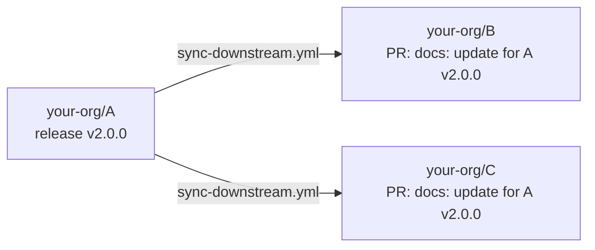

# GitHub Actions

When `GITHUB_ACTIONS=true`, the CLI also:

- emits `::error` annotations pointing at the directive's line, for failed commands, invalid directives and (with `--check`) out of date regions
- appends a summary to `$GITHUB_STEP_SUMMARY`
- writes `changed=<true|false>` and `failed=<n>` to `$GITHUB_OUTPUT`

## Using the action

The action builds the CLI from source, so it doesn't need an npm release. Install whatever your directives run (and `shell`) before it. With `"shell": "auto"` (the default) it runs directives' commands in `sh`; set `CMDSYNC_SHELL` in the workflow's `env` for another shell.

```yaml
- uses: actions/setup-node@v7
  with:
    node-version: 22
- run: yarn install --frozen-lockfile && yarn build   # makes `my-cli` available (or use the `install` config)

- uses: ndonfris/cmdsync@master
  with:
    mode: check            # `check` (default) fails on stale regions, `write` regenerates them
    # paths: README.md docs
    # config: ./cmdsync.json
    # args: --shell bash --command my-cli
    # working-directory: .
```

| Input | Default | Description |
| --- | --- | --- |
| `mode` | `check` | `check` or `write` |
| `paths` | `''` | Space separated files/directories (default: config `include`) |
| `config` | `''` | Explicit config path |
| `args` | `''` | Extra CLI arguments |
| `working-directory` | `.` | Directory to run in |
| `node-version` | `''` | Node.js to set up for cmdsync. By default the runner's Node is used when it's `>=22.18`, else Node 22 is set up (which also changes Node for the rest of the job) |

| Output | Description |
| --- | --- |
| `changed` | `true` when any region was (or would be) changed |
| `failed` | Number of failed or invalid directives |

## Regenerate and commit

```yaml
name: docs
on:
  push:
    branches: [master]
permissions:
  contents: write
jobs:
  cmdsync:
    runs-on: ubuntu-latest
    steps:
      - uses: actions/checkout@v7
      - uses: actions/setup-node@v7
        with:
          node-version: 22
      - run: yarn install --frozen-lockfile
      - id: cmdsync
        uses: ndonfris/cmdsync@master
        with:
          mode: write
      - if: steps.cmdsync.outputs.changed == 'true'
        run: |
          git config user.name 'github-actions[bot]'
          git config user.email 'github-actions[bot]@users.noreply.github.com'
          git commit -am 'docs: regenerate cmdsync regions'
          git push
```

## Without the action

The CLI behaves the same when called directly (annotations included):

```yaml
- run: npx cmdsync --check
```

## Updating other repositories on release

When repository **A** publishes a release, the docs in repositories **B** and **C** (READMEs, a docs site, an editor extension, ...) often need regenerating with A's new version. The reusable workflow [`sync-downstream.yml`](../.github/workflows/sync-downstream.yml) does that from A's release workflow: for each repository, it checks it out, installs the released version of A, runs cmdsync, and opens a pull request.



### In A: call the workflow on release

```yaml
# your-org/A/.github/workflows/release-docs.yml
name: release-docs
on:
  release:
    types: [published]
jobs:
  docs:
    uses: ndonfris/cmdsync/.github/workflows/sync-downstream.yml@master
    with:
      repositories: '["your-org/B", "your-org/C"]'
      version: ${{ github.event.release.tag_name }}
    secrets:
      token: ${{ secrets.DOCS_PR_TOKEN }}
```

`GITHUB_TOKEN` can't push to other repositories, so the workflow needs either:

- `token`: a fine-grained personal access token with **Contents: read and write** and **Pull requests: read and write** on B and C, or
- `app-id` input + `app-private-key` secret: a GitHub App installed on B and C with the same permissions. A token scoped to each repository is created per job, and the PRs are authored by the app.

### In B and C: a normal cmdsync config

Each downstream repository keeps its own `cmdsync.json`, so it decides what gets regenerated, and also works locally and in its own CI. The released version is exported as `UPSTREAM_VERSION`, for `install` commands and directives:

```json
{
  "shell": "bash",
  "commands": ["A", "jq"],
  "include": ["README.md", "docs/**/*.mdx"],
  "install": {
    "A": "npm install --global A@${UPSTREAM_VERSION#v}"
  }
}
```

````markdown
Current version: <!-- CMDSYNC start: A --version -->1.9.0<!-- CMDSYNC end -->

<!-- CMDSYNC codeblock: A --help -->
```text
```
````

The workflow always passes `--install`, so `A` is installed at the released version even if the runner already has some version of it.

### What the workflow does in each repository

1. Checks out the repository (`base`, default: its default branch) and sets up Node.js.
2. Exports `UPSTREAM_VERSION` (rename it with `version-variable`) and runs `setup` (e.g. `yarn install --frozen-lockfile`) if given. Files `setup` changes, such as a lockfile, are kept out of the PR.
3. Runs `cmdsync --install` in `working-directory`.
4. If anything changed, it commits to the `cmdsync/A` branch (`branch`), force pushes, and opens a PR, or updates the title/body of the PR that's already open. Each release updates the same PR instead of opening a new one.
5. Writes the PR link to the job summary.

Repositories are updated in parallel (a matrix with `fail-fast: false`), so one failing repository doesn't stop the others.

| Input | Default | Description |
| --- | --- | --- |
| `repositories` | (required) | JSON array of `owner/name` |
| `version` | (required) | Released version |
| `version-variable` | `UPSTREAM_VERSION` | Environment variable the version is exported as |
| `setup` | `''` | Shell commands run before cmdsync |
| `args` | `''` | Extra cmdsync arguments (`--install` is always passed) |
| `working-directory` | `.` | Directory to run cmdsync in |
| `node-version` | `22` | Node.js version |
| `base` | default branch | PR base branch |
| `branch` | `cmdsync/<A's name>` | PR head branch |
| `title` | `docs: update for <A's name> <version>` | PR title and commit message |
| `app-id` | `''` | GitHub App id (with the `app-private-key` secret) |

<!-- CMDSYNC start: node scripts/docs-nav.ts --footer docs/github-actions.md -->
---

[← Git hooks](git-hooks.md) · [Contents](README.md) · [Generating docs from your source code →](generating-docs.md)
<!-- CMDSYNC end -->
